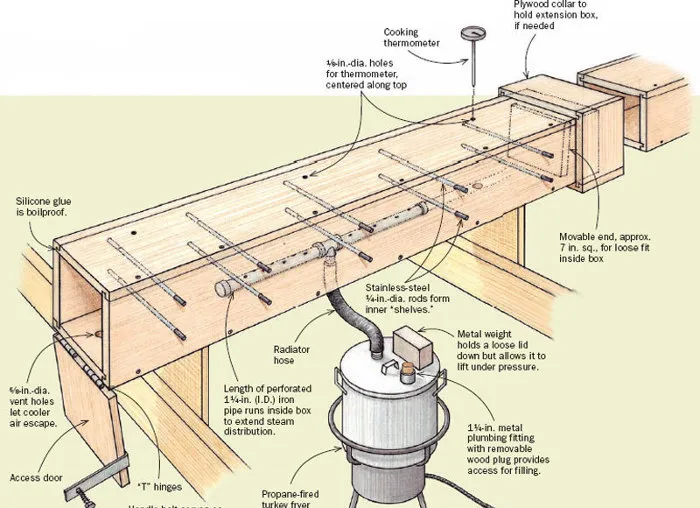
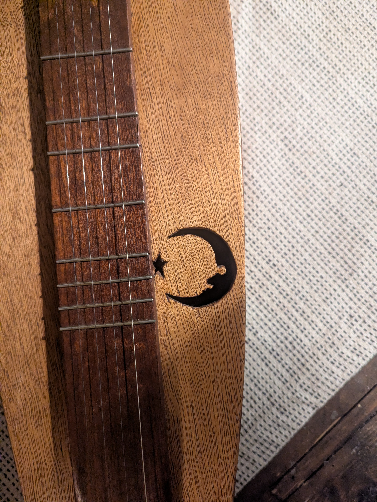
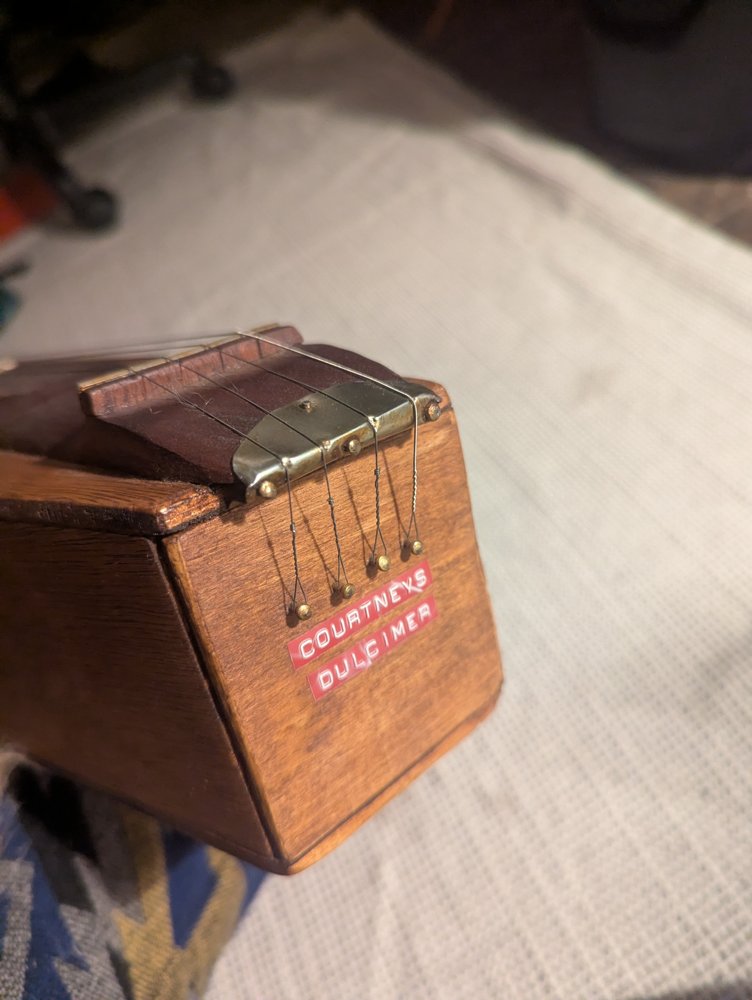
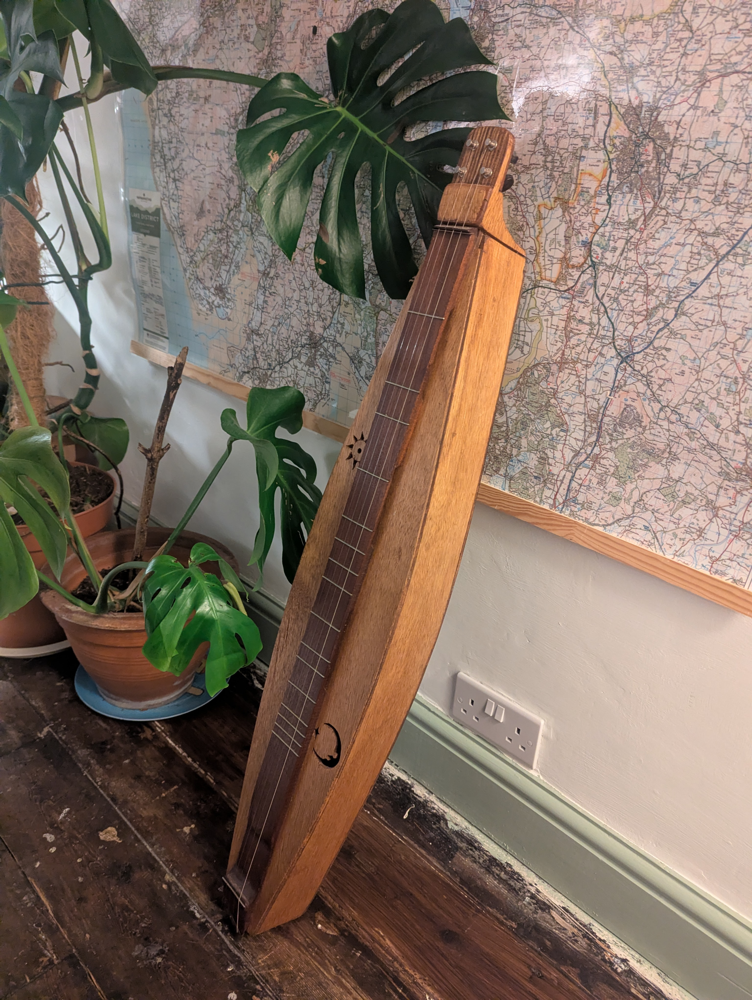

+++
title = "The Dulcimer"
date = 2026-11-07T11:00:00-07:00
draft = false
description = "An exploration into bodged luthiering"
tags = ["instrument", "woodwork", "bodge"]
categories = ["instrument"]
+++


This weekend we spent bonfire night at my sister's house setting off explosives around small children. As many people do this time of year. All because...as I recall from my primary school education...we need to commemorate the failure of the Gunpowder Plot of 1605. Pretty weird all round, but it's what we do, it's part of a tradition which is ever evolving and shifting away from its origin and more towards...well... setting off explosives around small children.

Anyway, this post is not about fireworks, or cinder toffee or sparklers. It's about an instrument, one I made many years ago.

So how do we make the smooth transition from fireworks to a woodwork project from over 12 years ago...well. While at my sister's house, with bangs and flashes going on outside, she proudly brought out a new instrument she had bought on vinted. A slightly dusty old zither, with documentation and music showing its origins in germany in the early 80s. She played a few hauntingly beautiful tunes and we got onto talking about unusual instruments. 

If you've not heard of a zither it's a string instrument, played horizontally; with an unreasonable number of strings, some to play melody and other set up to play chords. You pluck or strum and...well...music happens. Visually it looks very much like a hammered dulcimer and audibly it sounds quite like one too. You can read a much better explanation on the wiki page [here](https://en.wikipedia.org/wiki/Zither)

Now here comes the forced transition into my project. All this talk of horizontal plucked stringed instruments got me thinking about the time I attempted to build a very delicate instrument with not so delicate materials or method. An [Appalachian dulcimer](https://en.wikipedia.org/wiki/Appalachian_dulcimer).

I'd fairly recently acquired a banjo and was in the phase of my life where I was exploring bluegrass and American folk music, and I'd been watching videos where this strange instrument featured. It had a fascinating medieval sound to it and I wanted to know more, I wanted to play one, I wanted to **own** one.

At the time, looking online, they were prohibitively expensive, especially for someone who was working part-time as a cleaner for Wetherspoons and semi-illegally subletting a room to friends to afford the rent.

But that didn't stop me. I had my heart set on a dulcimer of my own, so I resolved to making one.

With a miniscule budget there was no expectation that this would be a good quality instrument, but I wanted it to be good enough as a toe-dip to determine if I should consider investing in a real dulcimer one day when funds allowed. So I popped down to B&Q and picked up the cheapest sheet wood I could find (some 5mm ply) and a strip of something for the fretboard.

By pure fluke B&Q were selling off some pieces of what should have been very expensive mahogany for a few quid due to some dinks and holes that made them apparently unsellable for their intended purpose. Luckily the length I needed would just miss off these imperfections.

If you clicked on the wiki link above or otherwise have seen a picture of an appalachian dulcimer, you'll notice its elegant form with nice curved edges and beautiful cutouts, but otherwise its just a fucking box with a chunk of wood slapped on the top.

Now I wasn't just going to make a plain old box, I wanted it to have _some_ elegance, but also I clearly wasn't going to achieve the same slim form of the professionally crafted versions. So somewhere in-between...a semi-elegant box if you will.

I was aware of steam bending of wood, and knew that this would be my method of adding this curvature, and it's at this part of the project where we are about to see some top tier bodging.

Usually one would have a setup with a dedicated box chamber for the wood to be placed in, a steamer, a thermometer, a pipe to ensure even distribution, a nice jig setup for forming the steamed piece, some heavy duty gloves to protect your hands and lots of clamps to safely hold things in place. Like this:

<figure>
  
  <figcaption>
    <strong>Illustration attribution:</strong> By Vince Babak, from “How to Build a Steambox,”
    Fine Woodworking, Issue 195 (2008). Reproduced for discussion and comparison.
    <a href="https://www.finewoodworking.com/2007/12/01/how-to-build-a-steambox">Original article: Fine Woodworking</a>.
  </figcaption>
</figure>

I had almost none of these things.

So instead I set up a few big pans of water on the hob, balanced my strip of plywood above on some containers of pasta and sugar, then covered the whole precarious setup with as many towels as I could find. After an hour or so of turning the kitchen into my own personal steam room I figured the wood must be soft enough so I grabbed it out and forced it around a very basic jig which consisted of 3 bits of scrap wood I'd haphazardly screwed into an old piece of sideboard.

I held it in place with the two clamps I owned and a good measure of hope and optimism.

The clamps held while I tended to my burnt hands and set up the next piece of wood to follow the same process.

By some miracle this seemed to have worked, and once cooled and dry the pieces of ply were nicely curved and looked about as good as I could have hoped.

I stuck several pieces of the ply together to form a head for the keys, which I bought online, along with some fret wire and strings. If memory serves this all came to about £20.

The rest was simple enough, glue the whole box together, carve down the head, give it a good sand and oil, hammer in the frets and string her up.

Ooh, the frets, now that bit was a fun rabbit hole. So appalachian dulcimers are [diatonically fretted](https://en.wikipedia.org/wiki/Regular_diatonic_tuning), so unlike a guitar which is chromatically fretted, the dulcimer follows a scale. So is tuned to a specific key.

The maths for this seemed scary but was actually simple enough.

```
Fret position = Scale length − (Scale length ÷ 2^(semitones ÷ 12))
```

So measuring the nut to bridge and using the above gave me all the positions for the frets. This was an exercise in blind trust in the maths, because I had only one fretboard (there was no way I was paying the full price for the mahogany), and only one chance as the frets were hammered into the wood itself. So I proceeded to mark the positions, check and check again then grit my teeth and hammer the fret wire into the nicely prepared and beautifully grained wood.

I cut a few holes into the body as sound holes, and filed them out with a rat-tail file to make a sun and moon motif. I remember this taking far longer than I expected probably because my rat-tail file was 100 years old and was basically a smooth piece of metal by this point.



The nut and bridge I fashioned from an old bean tin (maybe the bodgiest bit of the project), and once I'd strung up the strings from escutcheon pins up to the keys at the top I gave it a first strum. And bugger me, it sounded ok. Not perfect, but the sound resonated through the box nicely and it had a decent volume to it.



Here's a little video of me playing a terrible rendition of "Wild mountain thyme". Cue excuses why it sounds awful: "It's out of tune", "It's a bad recording", "I'm out of practice". In reality it's a bit shit and my ability to play is worse.

<video controls playsinline preload="metadata" style="margin:50px 0px 50px 0px; width: 100%; height: auto;">
  <source src="video_demo.mp4" type="video/mp4">
  Your browser does not support embedded video. You can <a href="video_demo.mp4">download the video here</a>.
</video>

So the appalachian dulcimer, as I said, is a diatonically fretted instrument. It has 2 drone strings and two melody strings. The great thing about this is that you can play pretty much anything at all, pressing down on any of the melody notes and it sounds nice. The downside is you're limited to songs in whatever key it is tuned to. 

It was done, it looked nice enough, played well enough and more importantly was a lot of fun to build.



A few extra offshoot projects came shortly afterwards. Sewing a case for it to protect my precious instrument, and fashioning a dulcimer-suitable capo for it from some washers, butterfly nuts a carriage bolt and a piece of rubber tubing. Again for all the bodging it worked pretty well.

Limitations are often treated as obstacles to creativity, but actually I think they’re frequently the cause of it. If I’d had plenty of money, I’d have just bought a dulcimer. If I’d had a proper workshop, I’d have built one properly. Having neither meant I had to find my own way. It reminded me I should embrace the limitations in my life because removing constraints doesn't necessarily give you more possibilities. Sometimes it just removes the reason to invent.

As I write this my sister has just messaged me asking how she could make a case for her new zither...I feel another bodge a-brewing.