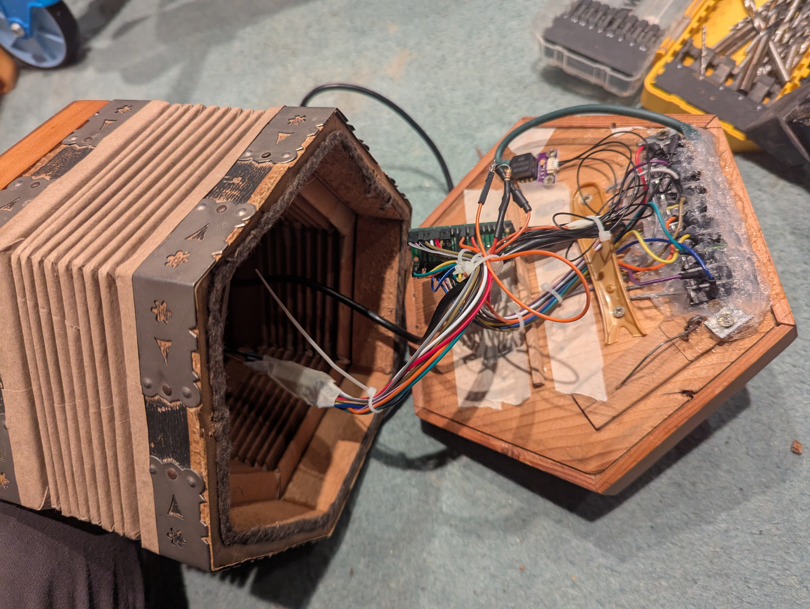

+++
title = "03. Putting the Bellows Back into the Concertina"
date = 2026-10-24T11:00:00-07:00
draft = false
description = "Adding pressure sensing, expression and a little bit of pipe organ to my homemade MIDI concertina."
tags = ["concertina", "MIDI", "electronics", "circuitPython", "code"]
categories = ["Projects"]
+++

In the previous part, I replaced the concertina's keys with microswitches and used a Raspberry Pi Pico 2 to send MIDI notes to my laptop. It played melodies and chords, but something important was missing: the bellows. Without them, there was no pushing or pulling to change the notes, and no way to control how hard the instrument was being played.

Before looking into what was available I considered the ways I might sense the movement of the bellows in this scenario. Perhaps something like a turbine/paddle wheel sensing the air flow in and out of the bellows. Or optically with a laser sensor at one end of the inside of the bellows checking the distance to the other side. Perhaps a small ball free floating in a tube which would be pushed up and down, with some optical sensor checking it. All of these sounded overly complicated and impractical but it was a fun thought experiment.

This concluded the important research phase known technically as "inventing several worse solutions before looking it up".

After a bit of _actual_ research I found an MPXV7002DP piezoresistive differential pressure sensor for about £10: the perfect candidate. It measures the pressure difference between its two input tubes, over a range of about -2 to +2 kPa by measuring the strain exerted on a thin silicon membrane. Thus I could have one tube open to the air outside the concertina and one connected to the inside of the bellows. The direction of that pressure difference tells me whether I'm pushing or pulling, while its size lets me change the expression or volume. 

In software, the sensor gives me a number rather than a useful phrase like "pushing quite hard". I subtract its resting reading to get a signed value: the sign gives me direction, and the size gives me pressure.

```python
reading = pressure_sensor.value
pressure = reading - PRESSURE_CENTRE  # Calibrated resting reading
direction = "push" if pressure > 0 else "pull"
strength = abs(pressure)
```



This took quite a bit of trial and error. The first few attempts were wildly out and needed some tuning to get it to do what I wanted, but in the end I got there.

The second issue I ran into is that the holes I'd cut for the switches were now severely leaking air from the bellows. I needed something to plug the gap, and settled on using some silicone. Even with a liberal application of silicone, it wasn't enough, so I applied a hefty layer of cling film and tape around the back of the buttons to plug up any leaks. 

Having briefly visited semiconductor physics, the project now returned to its core discipline: putting tape on things. Finally, it was airtight enough to use.

Despite getting the Anglo's push-pull note switching working initially, I found I preferred playing with my unisonoric setup and full chords in the left hand. Rather than hard-coding to one style, I chose to make it configurable with a flag that I could potentially hook up to another button but is currently just a constant which can be switched in the config.

The note selection can then depend on that setting: in Anglo mode, the bellows direction chooses between the two notes for a key; in unisonoric mode, it always uses the same one.

```python
if anglo_mode:
    note = pull_note if direction == "pull" else push_note
else:
    note = button_note
```

A final addition I made was to have it sound like it was overblowing when the pressure reading entered the top 10% of the range I was using. At that point, it would open some new MIDI channels with a new soundfont for the strained version, with the volume and expression increasing as the pressure rose, as with the first channels.

The extra sound is a pressure-triggered layer. This is the basic idea, leaving out the note-release and smoothing logic:

```python
if pressure_fraction >= 0.95:
    send_layer_note(note, expression=pressure_expression)
```

The great thing is I could also use this to play other soundfonts just for fun. For example, I could play quietly and calmly with a concertina soundfont, but if I really go for it with the higher-pressure action, we merge in some pipe organ. Or I can have a guitar soundfont and turn on overdrive electric guitar for the higher pressure.

For now I consider this the point at which the project is 'done'.

I could play any song I wanted, in any key, with any soundfont, and it sounded close enough to a real concertina for use as a fun practice instrument. Not sure if I set out with this as the intended outcome but again, the outcome was the learning rather than the finished product, and in this case the finished product was pretty good fun too.

I might return to this project one day to integrate the actual synthesiser into the body of the concertina, with a little speaker and an integrated battery, maybe using a Raspberry Pi for the synth, who knows. That's a project for another time. I've bodged this concertina enough, poor thing.

Looking back, I've learnt a surprising amount from what started as messing around with a £10 concertina: how concertina reeds and bellows actually work, how to read switches with a microcontroller, how MIDI notes and expression are controlled, how differential pressure sensors work, how to turn bellows pressure into something useful in software, and that cling film and tape are apparently legitimate instrument-building materials. The finished concertina is fun, but really it's just the thing left over after doing all of that.

[The first part](../electric-concertina/) is where the whole thing started; [the middle part](../electric-concertina-midi/) covers the electronics and MIDI setup.
