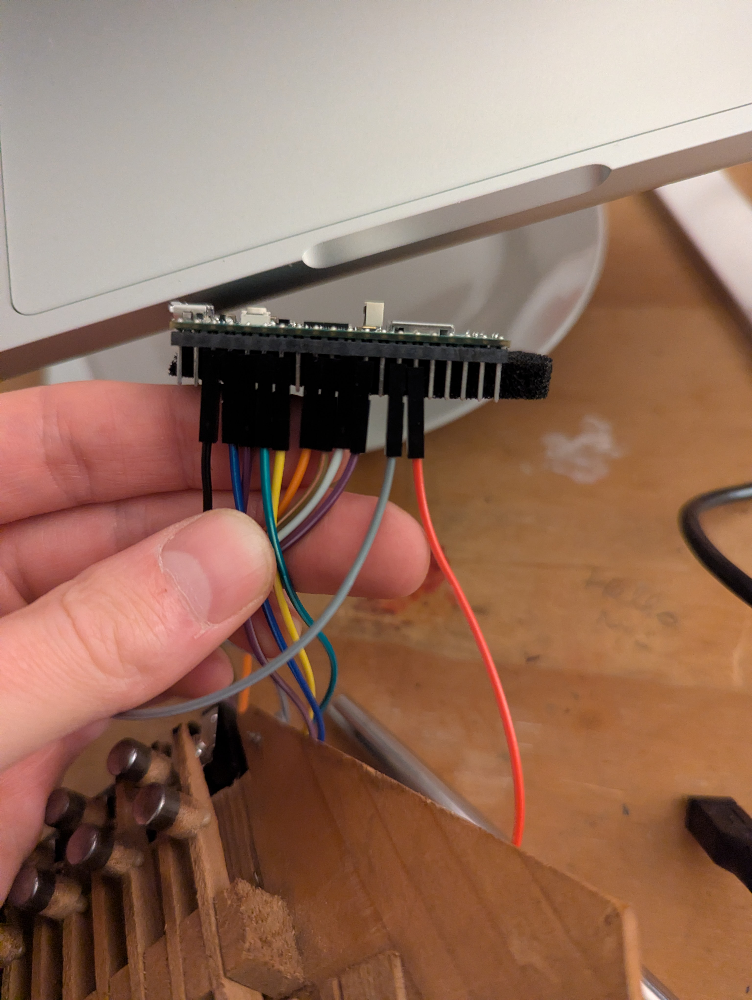
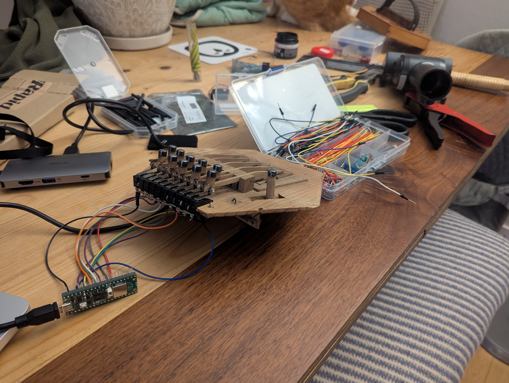
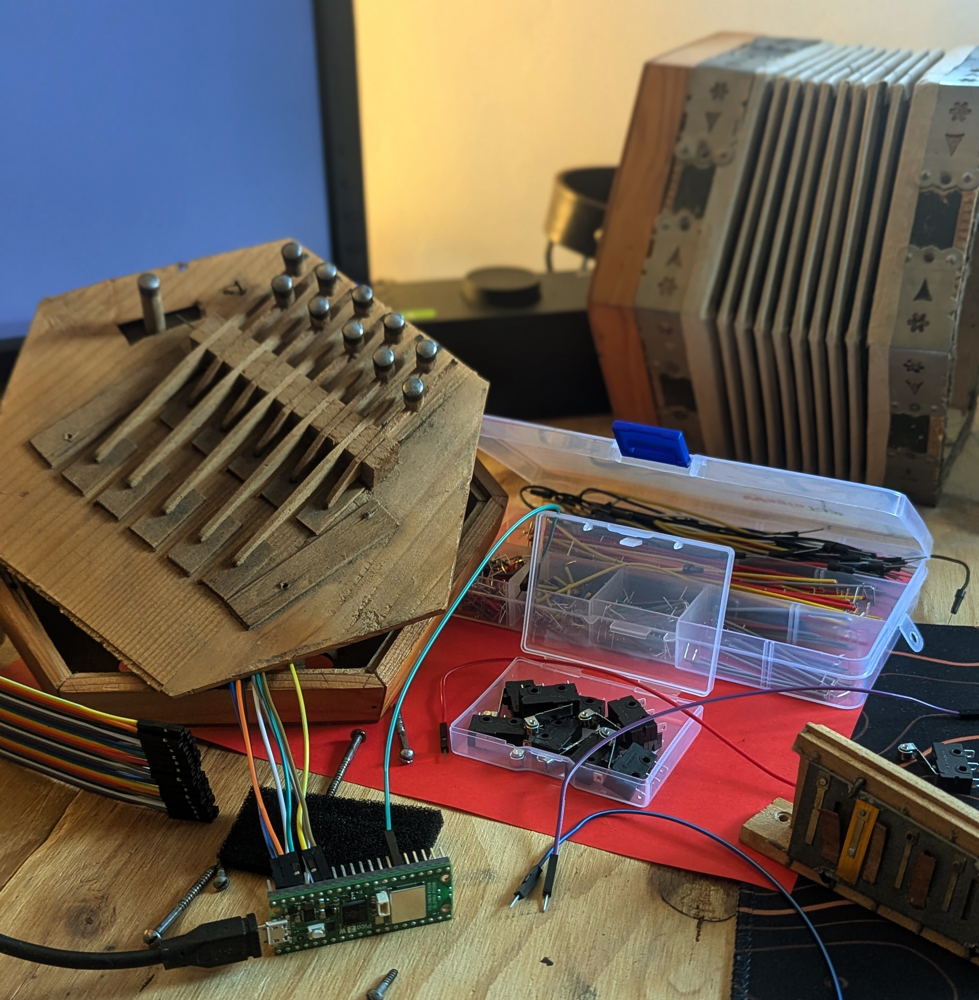

+++
title = "Turning a Concertina into a MIDI Instrument"
date = 2026-10-23T11:00:00-07:00
draft = false
description = "Replacing the concertina's leaky musical innards with micro switches, a Raspberry Pi Pico 2 and MIDI."
tags = ["concertina", "MIDI", "electronics"]
categories = ["Projects"]
+++

In the first part, I bought a battered £10 concertina, repaired its missing reeds with pieces of a charity-shop harmonica, and got it playing well enough to sit on a shelf. It stayed there until June 2026, when I bought an electric piano and wandered into the world of MIDI.

I'd wanted an electric piano for many, many years but never been able to justify it. With the arrival of my daughter, I could now justify it under the pretence that we should have one in the house for her to learn on. Apparently this is the perfect time to drop an unreasonable amount of money on something I totally don't need. Anyway, where were we?

While setting it up, I noticed the piano could be used as a MIDI keyboard. This took me into the magical world of MIDI, LMMS, soundfonts and synthesisers. Another rabbit hole, but let's stay on track.

After a few weeks of playing around, I spotted my concertina. The harmonica reeds weren't good enough to make it enjoyable to play, but what if it could be plugged in and become a MIDI concertina?

The plan: swap out the valve-opening keys for buttons and add some kind of pressure sensor for the bellows. How hard could *that* be? (Turns out, a bit. I feel like I've said that before.)

How to get the buttons to send MIDI messages? How to use a sensor to change the volume, expression, something else? Lots of questions and not many answers, but I had a completely unsupported confidence that I could make this work.

I checked online for similar projects, but found only one or two videos demonstrating electric accordions, with nothing about how they worked or how to begin.

I'd played around with the Raspberry Pi years ago, wiring up my doorbell to play a spooky recording for trick-or-treaters. But it was overkill for this, too. I wanted something smaller and lighter, which could send a MIDI message for a button press instead of triggering a WAV file.

Enter the microcontroller.

I found the Raspberry Pi Pico 2 online, and for about £5 it was a safe gamble. I ordered one and 10 microswitches to try one side as a proof of concept. Embedded development with the Pico 2 was *WAY* simpler than I'd imagined.

In a previous life, I worked with some very clever people making routers and access points. They handled the embedded development while I did basic front-end work. I remember them flashing firmware and writing C, doing absolute magic which went way over my head.

I expected this to be a challenge, but I could flash firmware over USB, write Python using CircuitPython and test my code instantly on the Pico 2. Surprisingly easy.

Notes: [CircuitPython](https://circuitpython.org/) is based on [MicroPython](https://micropython.org/) but with some extra bits in for Adafruit's hardware. Perfect for my little project using the Pico 2.

Once I'd written and flashed some simple CircuitPython firmware, I wired buttons to the GPIO pins and got them sending MIDI messages to my laptop. The proof of concept worked. Now I just needed to fit everything into the concertina and work out how to use the bellows.

I cut up the valve plates inside the concertina and placed the microswitches under the keys. Getting them secure without restricting the keys took trial and error, plus plastic offcuts for spacers, bent wire and small metal plates. I wired the ground pins together and soldered cut-off Dupont wires to each switch to plug into the Pico 2.

Side one done and tested, I ordered the next 10 switches for the bass side and, in the meantime, played around with setting up different configuration options for my concertina.

There are a few types of concertina: Anglo, English, Duet, Chemnitzer, all with varying keys and tunings. With no prior knowledge of concertinas, I'd bought an Anglo. Each key plays two notes, depending on whether you push or pull the bellows. Obviously, I couldn't replicate that without a bellows sensor.

So I initially configured it as a Duet concertina, with each key playing the same note in or out. Without a bellows sensor, it was simply: press button = play a note.

Because everything is controlled by software, I could switch between Duet, Anglo, English, whatever. An Anglo concertina is tuned to a given key, such as C/G, G/D or the older C/F, but software meant I could switch to any key I wanted.

While I waited for the remaining switches, I wrote a script to find the best-approximated bass chord to go with the melody from my 10 keys. A small side shoot of the rabbit warren I was already miles deep into.

Anyway, my other switches eventually arrived and I wired them up the same way and put it all together.

I found I liked adding chords to the melody, so I set the left 10 keys to play chords in the same key as the right hand, a bit more like an accordion. This isn't the right setup for a real concertina, but this isn't a real concertina. It's my own thing and it's whatever I want it to be.

I also set the left hand to be on one MIDI channel and the right on another so I could play the bass chords in one soundfont and the melody in another.

Finally, I could play a tune by passing the MIDI messages into a soundfont player on my laptop. I could choose something close to a real concertina or something completely different. I particularly liked playing a giant pipe organ on a tiny little concertina.

It worked, but the result still sounded a bit flat: more like a synthesised concertina than a real one. What was missing was the bellows. [In the final part](../electric-concertina-bellows/), I add a pressure sensor and find out what happens when an instrument can finally breathe.
