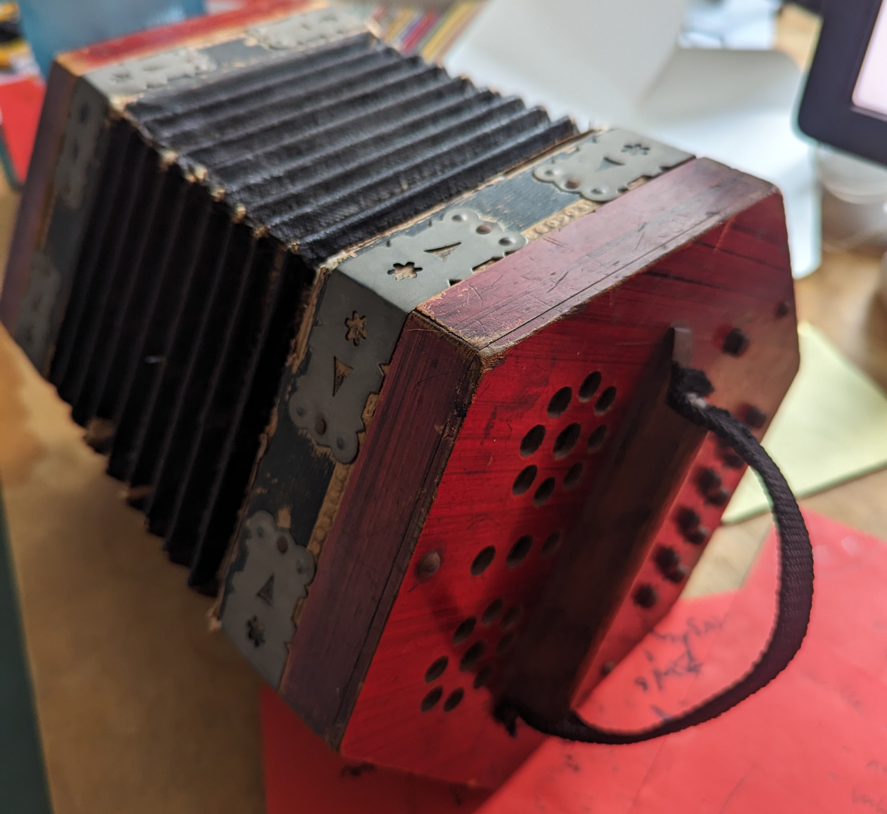
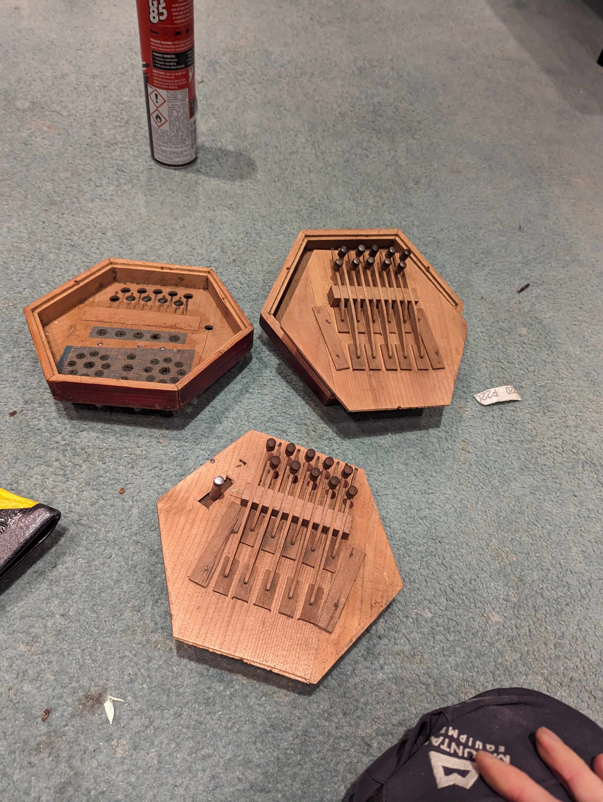
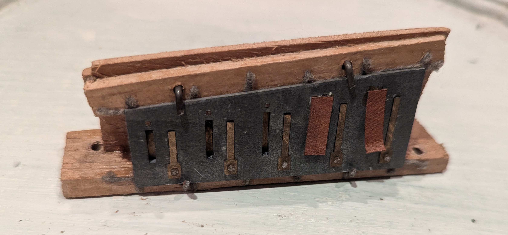
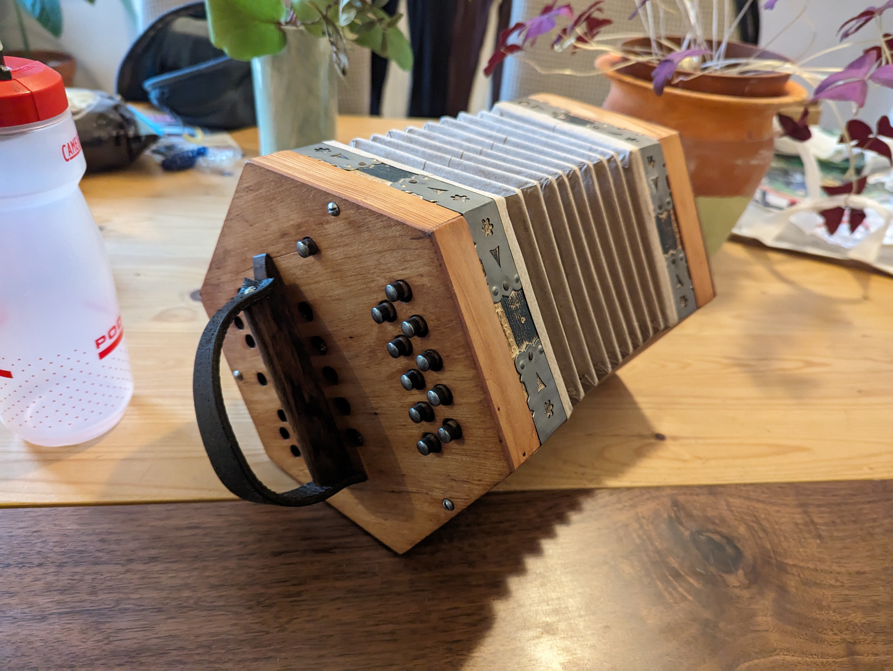

+++
title = "01. The £10 Concertina"
date = 2026-10-22T11:00:00-07:00
draft = false
description = "A broken concertina, a charity-shop harmonica, and the first bodge in a longer project."
tags = ["concertina", "repair", "bodge"]
categories = ["Projects"]
+++

This journey started back in March 2024, walking past a vintage junk shop when a battered and broken concertina caught my eye.

For the low sum of £10 it could be mine. I had no idea how to play it, no idea if it worked and, and no idea how to fix it if it was broken. But it looked like it would be fun finding out.

There's something quite freeing about starting a project you know nothing about. You haven't yet learnt which ideas you're supposed to dismiss as stupid.

It came home with me and within a few minutes I'd forced out a rendition of Twinkle Twinkle Little Star with only a few missing notes, not just due to my bad playing but that it was _literally_ missing some notes. It was evident at this point that not only was it badly out of tune, some of the reeds were either broken or missing, and the bellows were leaking like a sieve.

After a little coaxing and fiddling with some very rusty screws, I'd opened up the body of the concertina and saw some snapped reeds, fairly obvious holes and a lot of dust; otherwise it was in great shape.

Enter bodge #1.

What was I to do about these missing reeds? A quick Google search made it clear this could quickly spiral from a fun little project into a significant investment of time and, more importantly, money. All I wanted at this point was to bash out a full version of Mary Had a Little Lamb or Hot Cross Buns, with all the notes.

If I couldn't feasibly (read cheaply) get concertina reeds, what else could I use? I looked around the house and came across my old harmonica. Well, that uses reeds and they _look_ pretty similar. How different can they be? (Turns out, a bit.)

Anyway, rather than destroying my reasonable-quality harmonica and ending up with two broken instruments, I found a harmonica in a charity shop for £1 and quickly got to work dismantling it.

The reed plate was one solid piece with the metal reeds attached by a pin. On the concertina, the reeds were smaller metal plates held in a wooden frame. So far, so simple: just chop up the reed plate of the harmonica and replace the missing bits with ones that match the note I'm missing.

I'm sure anyone who knows anything about concertinas is now screaming at the screen with all the reasons this is a bad idea, but this *is* a bodge. My aim is not to restore this to a quality performance instrument, but, as always, to see if I could get close at minimal cost and with what I have lying around or easily available. I wasn't going to shell out a few hundred quid, or wait weeks for a shipment of reeds.

So chop up I did.

After a lot of blowing through small sharp bits of metal to find the right notes, I secured the reeds in place and put the whole concertina back together. I gave old faithful Twinkle Twinkle another bash and, although all the notes were there, the tuning still had something to be desired.

A bit more research and reading of some very helpful Reddit posts on tuning reed instruments like this and I found that to raise the pitch I had to remove some of the material from the end of the reed, and to lower the pitch I had to add some. Again, it seemed simple enough in theory. For all the flat notes I filed off a little metal at a time and used a tuning app on my phone to check. For all the sharp notes I added a little metal by melting a little solder to the tip of the reed, then tweaked by adding and removing until the note was right.

There was something pleasingly simple about the tuning: too much of something, take a little away; too little, add some back. No complex problem to solve, just trial and error. Like most things there was no moment where it suddenly became right, just lots of moments where it became slightly less wrong.

And hey presto, a semi-working concertina. All the notes there, all in tune. The only problems were that the harmonica reeds sounded a little 'tinny' and too much pressure in the bellows made them badly distort. Obviously the harmonica reeds were never intended for the pressure provided by a set of concertina bellows but for now it was close enough.

A sand down of the horrible red paint, some cardboard and glue for the bellows, an old belt for some new hand straps and some decorative pyrography: it could almost pass as a usable instrument.

And this is where my interest died. The project was done for now. I could get a tune out of it and enjoyed the process and the bodges along the way. Now it was 'working', it did a good job of sitting on my shelf for a few years until it came to life again in another bodge project.

## So what was the point in all this?

It was never going to be a proper restoration, and that was fine. I had fun figuring out how to get it playing, learned a bit about concertina reeds, and ended up with something that could just about manage Twinkle Twinkle. I learned that not all reeds are born equal and that glue and cardboard is a perfectly valid fix for some leaky bellows. The final thing was still a bit sketchy, but as I wrote in [Why Do I Bodge?](../welcome-to-the-blog/), the project itself is often the point not the final product.

That second project started when I bought an electric piano and discovered MIDI. The concertina was about to acquire buttons, a microcontroller and an entirely different set of problems. [The next part](../electric-concertina-midi/) picks up there.
