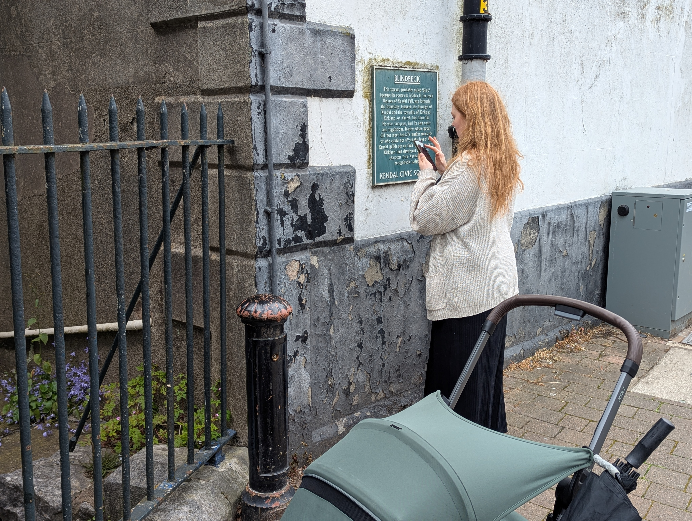

+++
title = "Kendal Pride Trail"
date = 2026-10-19T08:30:00-07:00
draft = false
description = "A write-up of the Kendal Pride Trail"
tags = ["javascript", "Code", "Community"]
categories = ["Code", "javascript", "community"]
+++

I find with most of my projects they begin with a problem _I_ want to solve, or bump into something that _I_ find interesting and before I know it I've lost all sense of time and lost all interest in anything else. The project becomes my purpose and it holds my attention until it doesn't at which point I let it go to float off into the ether.

Sometimes, however, the project comes from outside. A request from a friend, a suggestion from a colleague, or a problem which MUST be solved. And that's not to say I don't love and enjoy these projects, just that I find they need a little more structure, consistency and perseverance.

This is one such project. 

A friend and colleague came to me with a request. She was part of a planning group for an upcoming Pride event, and she'd had an idea.

For various reasons I won't go into here, there was a need to encourage attendees into and around the town centre rather than sticking to the main Pride village. 

Her idea was a guided trail.

A series of questions which guided you round the town with the lure of winning a small prize at the end, but also the promise that you would explore the town and find interesting queer-friendly spaces as you go.

She came to me with a few scraps of paper in hand with her rough idea for the route and some questions with the request that I help to flesh out the trail, the questions and perhaps inject some creativity into the project.

Now I love a puzzle, and setting puzzle questions is something I do annually for our company's charity quiz sheets which are sold around the local area. So my interest was piqued.

As a developer, my brain immediately went to: "we could absolutely over-engineer this into a web app"

So I set to making my demo version to showcase to her and some other organisers. 

Here's the premise:

A web app which gives you a question and a location; when answered correctly using information at the location, you get the next question. This pattern continues until you reach the final destination. We can keep score of the questions answered, offer optional hints and give fun facts about the local area.

By this point my heart was set on the idea, and it didn't matter what my colleague thought of it. I was making it anyway, whether for this event or for myself. Luckily the organisers loved it and we had the go-ahead.

It would also be a great opportunity to brush up on some front-end skills that have become a bit rusty of late.

I worked with the website team to get set up on a subdomain and align with their brand guidelines. Something as a back-end dev I've not had to consider before.

I set up a new React project and bashed out some components - one for the answer input, the questions, the hints, plus logic for scoring, skipping questions etc. All the basics needed.

To help navigate I added a little map using [Leaflet](https://leafletjs.com/) and stuck a pin at the user's location and the location of the question they were on based on their device's GPS.

The template and structure were complete. I had the whole thing sorted apart from the questions.

This was a new challenge, not something I could simply sit at home on my computer and work through. I took to the streets, notepad in hand, and followed the rough trail route noting down points of interest, architecture, dates, plaques, statues, and things I'd not noticed before in my hometown. The place I'd lived for 30+ years had become a new landscape of things I'd never noticed. 

This act of noticing was what I wanted to impart on whoever took on my little trail. To find little hidden away secrets of the town, as a reward for playing along.

It struck me that this is true far beyond little side projects: most of life only makes sense in hindsight, once you've walked the route and realised the interesting bits were between the checkpoints.

I also wanted the player to feel clever. Something I think is really important in question setting is to be something that when you figure it out you feel clever, and you feel the question and answer are clever. You get a moment of appreciation for the question before you're enticed into the next one.

This can sometimes tread a thin line between too easy and too hard, and for this I erred on the side of too easy. 

To make it clever I tried to link the questions together. One answer to a question would actually lead you to the next rather than being isolated. Trying to make the questions feel like a cohesive trail you are following rather than a list of items to check off.

This was easier said than done, and required many play tests. Luckily, with our baby having arrived a few months earlier and pram walks being a great way to get her to sleep, there was no shortage of time for plodding the trail and checking everything linked up nicely.

The trail was ready so the final parts were to slap on some pride flair with animations, effects, bold imagery and colours to match the main website brand guidelines.

For this I used [GSAP](https://gsap.com/) to draw a line as the user scrolled to draw an animated path through the town. Similarly I used this to make images jump in and out of view as you scroll.

I then used [Lottie](https://lottiefiles.com/) for some cool animations which played while scrolling.

<video controls muted playsinline preload="metadata" style="margin:50px 0px 50px 0px; width: 100%; height: auto;">
  <source src="pride_trail_recording.mp4" type="video/mp4">
  <source src="pride_trail_recording.mov" type="video/quicktime">
  Your browser does not support embedded video. You can <a href="pride_trail_recording.mp4">download the screen recording here</a>.
</video>

It was done. The trail was launched, advertised around the event, and we added some Google tags to track how many users participated and how far through they progressed.

Although this was not something I had necessarily chosen to undertake purely for the love of it, having a deadline and people holding me to account (loosely) did give this project a feeling of urgency, importance and a requirement for more attention to detail than my usual chaos.

I learned a fair bit about React development, web animations and Azure hosting from this project - some of which I have put into practice again for this blog.

In the end it felt less like building a website and more like building a small rehearsal for real life: imperfect maps, partial clues, occasional hints, and a lot of faith that the next turn will reveal something useful.

At the time of writing the site is still up and available at [https://trail.kendalpride.co.uk/](https://trail.kendalpride.co.uk/) if you want to take a look. Who knows I might do it again next year. If so, I'll try to remember to archive it for future readers, and make a follow up blog on the new and improved Kendal Pride Trail.
