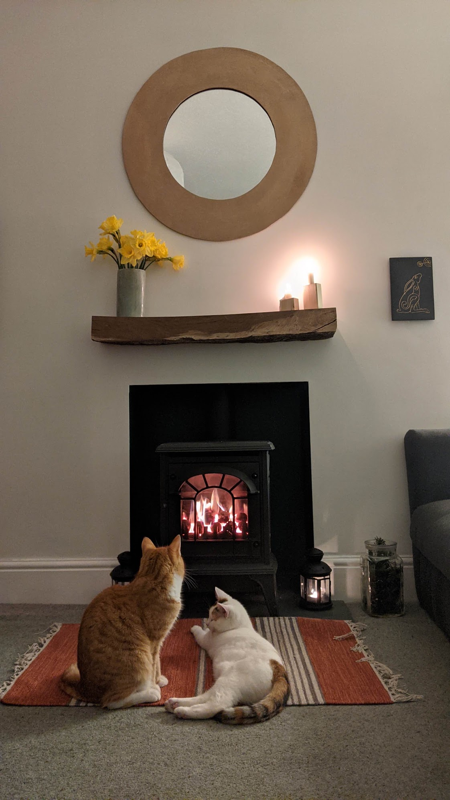

+++
title = "MINI - The Mantelpiece"
date = 2026-11-15T11:00:00-07:00
draft = false
description = "A mantelpiece held up with hope"
tags = ["mini",""]
categories = ["mini"]
+++

---
This is a mini post, one of my brief accounts of insignificant undertakings, and the learnings along the way (if there are any).
---

Above our fireplace in the front-room of our 1890s Victorian house sits what looks like a very solid hunk of wood serving as a beautiful live edge mantelpiece. But looks can be deceiving. 

Despite seeming like it could support the weight of a small car, this thing can barely support its own bulk, nevermind the candlesticks, plants, ceramics and other bits and bobs we keep on it on rotation.

The wood was sourced from my father-in-law's enviable collection, having stood outside for what looked (from the state of it) like decades; covered in a nice layer of algie, lychen, moss and detritus. A probably far too brief period of drying out a quick plane, however, revealed a stunning oak grain with a contrasting two toned piece.

Now here comes the real meat of this bodge. How to attach it to the wall.

There are many good ways of attaching stuff to walls, and many bad. Some cost money, some are cheap, some are weak, some are strong, some are visible others are cleverly hidden. Some involve grabbing things from your basement and stubbornly shoehorning them into a purpose they was never intended for.

I chose the latter.

So I grabbed 2 large carriage bolts, hacked off the ends, drilled two holes into the 2ft thick limestone chimney breast and matching holes in the back of my hunk of wood, then brutally hammered them together.

The result, a piece of wood attached to the wall. Not strong, not neat but enough that it allowed us to temporarily make a mark on our new house and make it feel more like a home with a mantelpiece. And just like many of my temporary solutions...here it has sat for the last 6 years, and may well for many more.

In the back of my head I still plan to take make good of this bodge, and attach it in such a way it really could support the weight of a small car, but on the priority list of life this sits low.

And at what point does a temporary solution stop being temporary?

Is it when you stop intending to replace it? When enough time has passed? Or when you've simply accepted it?
If something has served its purpose for six years, was it really such a bad solution?

That doesn't make the mounting safe, of course. A heavy, inadequately secured mantelpiece is worth fixing regardless of how long it's stayed up, but perhaps there's a distinction between a solution being good and a solution being good enough. The trouble is knowing whether you've found that distinction or merely been fortunate enough not to discover it yet.

Here's an old picture I found of it with a similarly bodged mirror hung above. The mirror, however, had a different fate and has since been replaced with a much more professional bought version.
