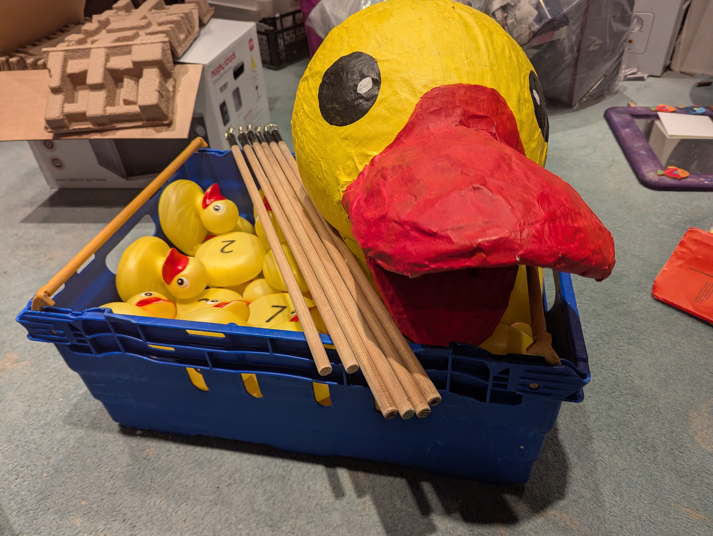
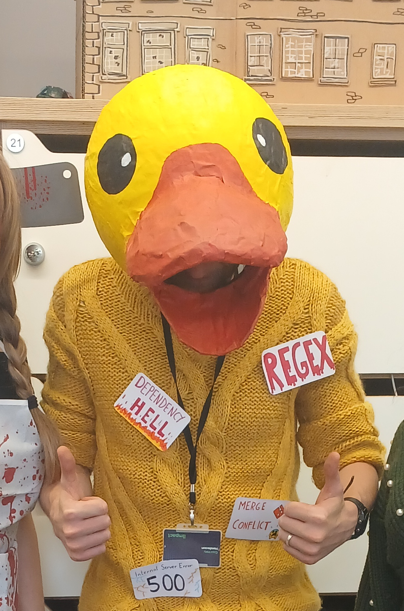

+++
title = "The Duck Head"
date = 2026-11-02T08:30:00-07:00
draft = false
description = "A writeup of the Duck Head"
tags = ["Papier-mâché", "costume"]
categories = ["Papier-mâché", "costume"]
+++

I'm writing this after a long weekend of spookiness, sweets and pumpkins. It was our first Halloween with our little one, who donned multiple costumes and encountered many things which by all accounts should have scared the shit out of her. But being completely unaware of what is normal and what is not, she took her father coming home as the Grim Reaper comfortably in her stride.

This got me thinking about the costumes I've made over the years. Very rarely will I buy a costume, in fact I can't remember a single costume I have bought, yet I will *ALWAYS* dress up given the chance. I love seeing historical pictures of people dressing up, traditional folk customs involving a (horse skull)[https://en.wikipedia.org/wiki/Mari_Lwyd], Samhain Mumming and Guising and the creepiest Victorian-era Halloween costumes.

Not only are these genuinely terrifying, but they are all home-made, cobbled together from things you find around you, crafted by hand, not always with precision or skill but unequivocally human-crafted; you might say *bodged*.

One such costume I made in recent years has become a bit of a running gag at work and has been brought out time and again outside of its original purpose as a Halloween costume.

Let's travel back a few years to the Halloween of 2024...oooh, wavy flashback transition.

Our team at work had recently been restructured and some non-technical folk had joined us as we merged closer to the wider business. As a team we had become accustomed to using technical language around each other, never needing to explain ourselves when we spoke of taking production dumps, killing the child processes and terminating orphaned workers.

One thing we often did was rubber ducking. Now if you're a developer you won't bat an eye when I mention this, but out of context I admit it does sound a little weird. For the non-initiated the idea is that if you run into a problem you can't solve you explain the issue (generally the code you're working on) step by step to an inanimate object. The classic example is a rubber duck. The process of explaining it often results in you finding where the problem is and thus the rubber duck has saved the day again. You can read more about the origins on the wiki page for it (here)[https://en.wikipedia.org/wiki/Rubber_duck_debugging]

Now sometimes the rubber duck doesn't need to be an inanimate object, it can be an animate one, one such as myself. I often find myself being the duck for other developers, and love the feeling of helping others out by simply sitting there with a vacant expression while someone talks through their problem, solves it themselves and promptly thanks me.
No greater joy than the feeling of being productive by doing bugger all.

It was one such occasion where I had been thanked by a colleague and I casually responded, "no worries, happy to be a rubber duck any time.", at which point my new manager pricked up her ears and pulled a face as if to say, "sorry, what the fuck are you on about?"

Anyway, after some explanation it became a running joke in our team that I was the rubber duck, something I happily leaned into on the Halloween in question, where I fashioned my own duck head and plastered myself with development-related questions and problems which haunt me at 4 in the morning. Merge conflicts, 500s and my least favourite thing regex. If none of those made any sense to you, that's ok, it didn't make sense to 99% of my non-dev colleagues either.

The duck head was created using skills I perfected at the ripe old age of 7. Papier-mâché.
Versatile, time-consuming, but solid messy fun.

I started with a balloon, as all good papier-mâché should, then plastered it with strips of the local Wezzy Gezzy, plenty of glue and water and repeated day after day until a nice hard shell had built up.

Feeling just like my childhood hero Neil Buchanan, I cut some cardboard for the beak, carved out a hole for my head and got to work adding a few more layers of paper and glue.

A lick of paint and it was done. Ready for a full day of work, sweating away in a toasty office with the aviary equivalent of a motorcycle helmet on my head, just with far less visibility or protection.

For all the effort that went into the duck head I'm glad to say Halloween 2024 was not its last appearance.

I have since worn it to a few of our lunchtime cold-water river dips and our summer BBQ, where I ran the hook-a-duck stand. It also makes an appearance whenever nieces or nephews come to visit.

Reflecting on this made me wonder: why did I do this? Why didn't I just buy a vampire costume like a normal person? Why spend countless hours taking a running gag far more seriously than it deserved? 

I think there's something important in the stupid little things that develop between people. One daft comment becomes a running gag, the running gag becomes a tradition, and before long it's entered the peculiar little mythology of a group of people. A completely inconsequential thing that somehow matters. 

We've been thinking a bit about company culture at work recently, and I think this encapsulates what it means to me. Groups of people seem naturally to build their own little mythology: running jokes, stories, traditions and unwritten rules that accumulate over time. Individually they're mostly nonsense, but collectively they give you that strange, but warm fuzzy feeling of belonging to something.

In my case, apparently, that something involves a papier-mâché duck.

The duck head is objectively worse than something I could have bought. But I made it, I'm proud of it, just like all my other bodges.

The imperfections are just proof that a human being was here.